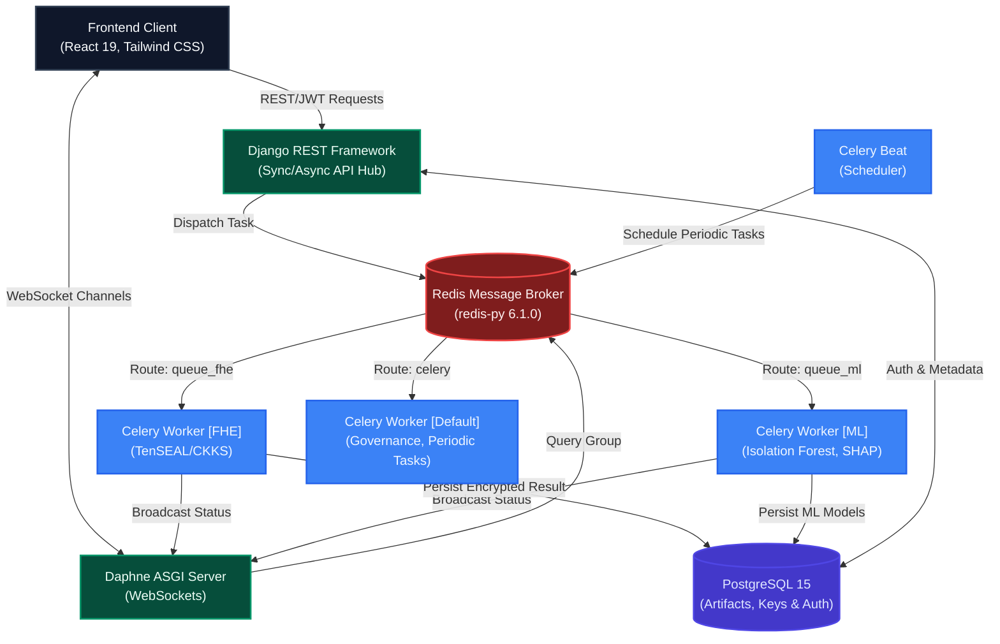
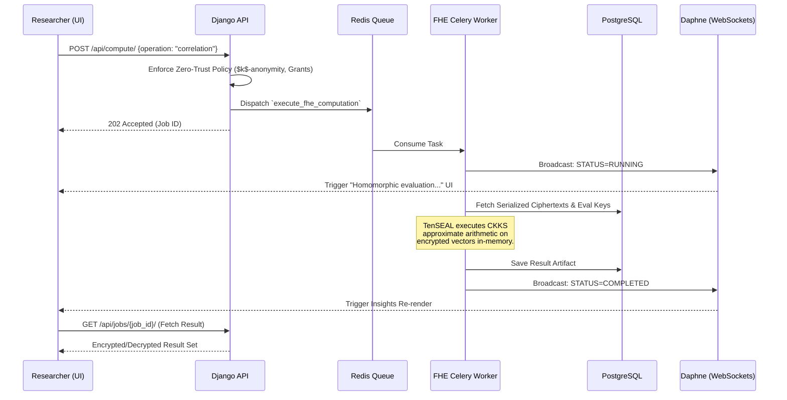

<div align="center">
  
# 🔐 Cipher Analytics  
**Enterprise-Grade Homomorphic Data Analytics & Zero-Trust Governance Platform**

[](https://www.djangoproject.com/)
[](https://reactjs.org/)
[](https://www.postgresql.org/)
[](https://docs.celeryq.dev/)
[](https://www.docker.com/)

> **Compute on encrypted data. Never expose raw values. Verify zero-knowledge computations.**

</div>

---

Cipher Analytics is a secure, zero-trust data processing platform designed for institutions, researchers, and enterprises. It enables the execution of statistical analysis and machine learning workloads on sensitive datasets **without decrypting them on the server**.

The platform demonstrates the applied use of **Fully Homomorphic Encryption (FHE)** integrated into a production-ready, distributed backend system with an editorial, institutional-grade frontend user experience.

---

## 🚨 The Privacy-Utility Tradeoff

Traditional systems require decrypting data before computation, exposing plaintext in memory. This introduces critical security vulnerabilities, insider threats, and compliance risks (GDPR, HIPAA).

**Cipher Analytics solves this by ensuring:**
1. Data is encrypted before storage and remains encrypted during rest and transit.
2. **Backend memory never handles raw numeric values directly during arithmetic operations.**
3. A zero-trust governance layer dictates strict access policies (Strict, Whitelist, Aggregated) to mitigate inference attacks.
4. **$k$-Anonymity & Differential Privacy defenses** ensure query results cannot isolate individual records ($n \ge 5$).

---

## 🏗 Distributed System Architecture

The platform is engineered around an asynchronous, event-driven microservices architecture, built to handle the computational overhead of homomorphic encryption seamlessly.



---

## 🔐 Cryptographic Execution Flow

How does a computation actually happen without exposing data?



---

## 📊 Analytical & ML Capabilities

| Capability | Underlying Engine | Security Posture | Output Visualization |
|------------|-------------------|------------------|----------------------|
| **Descriptive Statistics** | TenSEAL (CKKS) | `FHE Executed` | High-precision numeric summaries & variance bounds |
| **Pearson Correlation** | TenSEAL (CKKS) | `FHE Executed` | Dynamic correlation matrix heatmaps |
| **Outlier Detection** | Scikit-Learn (Isolation Forest) | `Encrypted Persistence` | Interactive scatter plots & anomaly tables |
| **Explainable AI (SHAP)** | SHAP TreeExplainer | `Model Extraction` | Feature importance & dependency bar charts |

---

## 🛡️ Zero-Trust Governance Models

To prevent statistical inference attacks and ensure data owners maintain absolute sovereignty, the system enforces strict governance policies:

| Policy Mode | Description | Security Constraints |
|-------------|-------------|----------------------|
| **`STRICT`** | Highest security tier. Requires an explicit, active **Research Grant** approved manually by the Data Owner. | Time-bound access, explicit revocation, full audit trails. |
| **`WHITELIST`** | Enterprise tier. Requires the user to be pre-authorized in the dataset's internal access registry. | Bypasses individual grants but requires admin provisioning. |
| **`AGGREGATED`** | Hardened metadata-driven tier. Allows limited computation to any authenticated user. | Enforces **$k$-anonymity** thresholds ($n \ge 5$), rejects high-cardinality probing, restricts subset filtering. |

---

## 🎨 Enterprise Product & Authentication Experience

The user experience has been completely engineered with institutional rigor:

- **Public Landing Page (`/`)**: Comprehensive overview covering cryptographic foundations, interactive FHE pipeline visualizations, institutional role breakdowns, mathematical proofs, and security architecture.
- **Asymmetric Split-Screen Authentication (`/login`, `/register`)**:
  - **Laptop & Desktop Screens (`lg:`)**: Side-by-side asymmetric split screen. Left side features architectural telemetry in an enterprise slate/neutral grey palette detailing CKKS-RLWE parameters ($N=8192$, 240-bit modulus chain) and role provisioning. Right side features a compact, white-first form that fits **without vertical scrolling on standard laptop viewports** (`lg:h-screen lg:overflow-hidden`).
  - **Smartphone & Mobile**: Intelligently stacked with the form at the top (`order-1 lg:order-2`) for immediate sign-in/registration, followed by the technical details rail below (`order-2 lg:order-1`) for on-demand scrolling.
- **Enterprise Design Direction**: Clean white-first aesthetic, deep charcoal typography, subtle 1px borders, zero childish neon blobs or glowing gimmicks, and strict WCAG AA contrast compliance.

---

## ⚙️ Technology Stack Deep-Dive

### Backend & Cryptography
- **Django 5.0 + Django REST Framework**: Enterprise API gateway with JWT-based identity tokens and granular permissions.
- **Celery 5.3 + Redis 7 (`redis==6.1.0`)**: Asynchronous distributed task execution, segregated into specialized queues (`queue_fhe`, `queue_ml`, `celery`).
- **Celery Beat**: Periodic task scheduler for token pruning, grant expiration audits, and system telemetry heartbeats.
- **Django Channels + Daphne ASGI**: Real-time WebSockets delivering instant computation progress updates without polling.
- **TenSEAL (CKKS)**: Microsoft SEAL wrapper configured with polynomial degree $N = 8192$, scale $\Delta = 2^{40}$, and a 240-bit modulus chain for parallel floating-point arithmetic across 4,096 SIMD vector slots.
- **PostgreSQL 15**: Relational integrity and BLOB storage for serialized ciphertexts and evaluation keys.

### Frontend
- **React 19 + Vite**: Modern, high-performance unbundled single-page application.
- **Tailwind CSS**: Strict utility-first styling with custom design tokens for data-dense dashboards.
- **React Hook Form + Zod**: Enterprise-grade client-side schema validation with real-time entropy calculation.
- **Recharts & Lucide Icons**: Responsive SVG visualizations for ML and analytical insights.

---

## 🚀 Getting Started

The entire stack is containerized for seamless local deployment.

### Prerequisites
- Docker & Docker Compose
- Git

### Deployment

```bash
# 1. Clone the repository
git clone https://github.com/ashif-ek/cipher-analytics.git
cd cipher-analytics

# 2. Start the distributed cluster (Detached mode)
docker compose up --build -d

# 3. Verify running containers
docker compose ps
```

### Accessing the Platform
- **Public Website / Landing Page**: `http://localhost:5173/`
- **Enclave Sign In**: `http://localhost:5173/login`
- **Enclave Registration**: `http://localhost:5173/register`
- **Backend API**: `http://localhost:8000/api/`
- **Celery Flower Dashboard**: `http://localhost:5555`

---

## 🔮 Future Roadmap

- **Client-Side WASM Encryption**: Push the encryption/decryption boundary directly to the browser (via WebAssembly SEAL integration) to achieve complete client-side zero-knowledge key generation.
- **Hardware Enclave Acceleration**: Leverage Intel SGX / AMD SEV confidential computing nodes for combined hardware-cryptographic security guarantees.
- **Multi-Key FHE**: Collaborative multi-party computation across datasets encrypted under disparate public keys.

---

## 💡 Why This Project Matters

Cipher Analytics represents a fundamental departure from legacy security postures:
- **Applied Cryptography** in a production-ready, distributed pipeline.
- **Distributed Systems Engineering** handling heavy, non-blocking workloads asynchronously.
- **Enterprise-Grade Discipline** via decoupled microservices and strict state machines.
- **Privacy-Preserving Computation** proving that high-utility analytics and mathematical confidentiality can coexist.

<div align="center">
  <br/>
  <i>Systems that require decryption to function are inherently vulnerable. <br/> Cipher Analytics challenges that assumption.</i>
</div>
